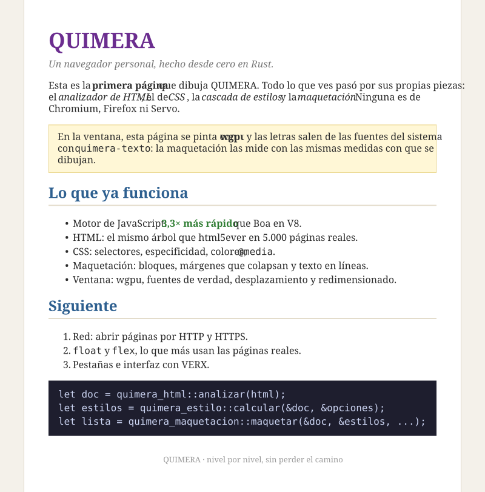

# La ventana: QUIMERA en pantalla con wgpu



```bash
cargo run --release -p quimera-ventana                      # la página de ejemplo
cargo run --release -p quimera-ventana -- pagina.html       # cualquier página local
cargo run --release -p quimera-ventana -- https://example.com/   # por red (docs/RED.md)
cargo run --release -p quimera-ventana -- pagina.html --captura salida.png 1024 768
```

## Navegar

| Qué | Cómo |
|---|---|
| Seguir un enlace | Clic. Sobre un enlace el cursor es una mano, y abajo a la izquierda se ve a dónde lleva (ya resuelto). Un `#ancla` de la misma página desplaza hasta su `id` sin recargar |
| Escribir una dirección | Clic en el campo, Ctrl+L o F6; Enter para ir, Esc para salir. `example.com/x` → `https://`; `localhost:8080` → `http://`; también rutas locales. Lo que no es una dirección no se envía a ningún buscador |
| Atrás / adelante | Botones ← →, Alt+← / Alt+→, o los botones laterales del ratón |
| Recargar | ⟳, F5 o Ctrl+R |

Las páginas se cargan en **otro hilo**: la ventana sigue respondiendo y la línea de estado dice «Cargando...». Si mientras tanto se pide otra página, la primera se descarta al llegar. El historial guarda la URL final, tras las redirecciones.

La barra se dibuja con los mismos cuadros y letras que la página, en una **capa fija** de la GPU: el sombreador no le aplica el desplazamiento (los vértices fijos llevan +2 en su modo), y la página se dibuja debajo, corrida el alto de la barra.

La maquetación guarda **dónde está cada enlace** (un rectángulo por trozo de línea, también para los `<a>` que envuelven bloques o imágenes) y **dónde está cada `id`**, que es a donde llevan los `#ancla`.

## Desplazar y redimensionar

La rueda del ratón, las flechas, Re Pág/Av Pág, espacio, Inicio y Fin desplazan la página. Al redimensionar la ventana se vuelve a maquetar con el ancho nuevo (y se reevalúan los `@media`), y F5 vuelve a cargar la página (del disco o de la red). El título de la ventana es el `<title>` de la página y su sitio.

`--captura` dibuja con la misma GPU, con la barra, en una imagen y la guarda como PNG. Sirve para comprobar el pintado sin mirar la pantalla. Con `--seguir N`, antes sigue el enlace número N de la página: así se comprobó que de `info.cern.ch/hypertext/WWW/TheProject.html` el enlace `../DataSources/Top.html` lleva a `/hypertext/DataSources/Top.html` y se dibuja.

## Las piezas

| Crate | Nivel | Qué hace | Crates de fuera |
|---|---:|---|---|
| `quimera-texto` | 2 | Busca las fuentes del sistema (Windows: Georgia/Times, Segoe UI/Arial, Consolas/Courier; Linux: DejaVu, Liberation, Noto), mide con interletraje, da ascenso y descenso, y rasteriza letras. Si a una cara le falta un carácter (`•`, `→`, emoji), lo busca en las de reserva | `ab_glyph` 0.2.29 (Rust puro) |
| `quimera-gpu` | 2 | Una sola tubería wgpu que dibuja **cuadros**: rectángulos de color y letras recortadas de un atlas de un canal, todo en una pasada y con alfa premultiplicado. Desplazar solo cambia un uniforme; no se vuelve a subir nada | `wgpu` 24.0.5 |
| `quimera-pintar` | 10 | Lista de dibujo → cuadros. Rasteriza cada letra una vez por tamaño en el atlas y sube a la GPU solo las filas nuevas; si el atlas se llena, se vacía y se vuelve a llenar. Da a la maquetación las **mismas medidas** con que luego dibuja | — |
| `quimera-ventana` | 12 | La ventana: eventos, redimensionado, desplazamiento, captura PNG (codificador propio, sin dependencias) | `winit` 0.30.12, `pollster` 0.4 |

`quimera-pintar` no toca la GPU: produce cuadros y píxeles del atlas, así sus pruebas no necesitan tarjeta gráfica.

## Decisiones

- **Colores en sRGB, como los navegadores.** La superficie usa un formato sin sRGB: los colores de CSS se mezclan tal cual, sin pasarlos a lineal.
- **Letras nítidas.** Las letras se colocan en píxeles enteros y se muestrean sin filtrar. Con pantallas de alta densidad, la maquetación va en píxeles CSS y el pintado multiplica por la escala de la ventana (las letras se rasterizan a su tamaño real).
- **Una sola llamada de dibujo** para toda la página: la página de ejemplo son 810 cuadros, y la de `Vec` de la documentación de Rust, unos 100.000.
- **Sin `unsafe`.** wgpu crea la superficie a partir de un `Arc<Window>` con su API segura.

## Medida

La página de ejemplo, en una ventana de 1024×768: leer, analizar, estilo, maquetación con fuentes de verdad y cuadros en **0,6–0,8 ms**. Al desplazar solo se dibuja (un uniforme y una llamada).

## Falta

- Las familias con nombre (`font-family: "Fira Sans"`) aún caen en su genérica; hace falta buscar fuentes por nombre.
- Imágenes (hoy un recuadro gris), selección de texto, barra de desplazamiento, mover el cursor dentro del campo de dirección, pestañas.
- La interacción en vivo (pasar el ratón, pulsar, escribir) se prueba a mano en la ventana; su lógica (historial, edición del campo, direcciones escritas) tiene pruebas.
- Pestañas, historial y barra de direcciones (`quimera-navegador`), y la interfaz con VERX. La red ya está (`quimera-red`, ver [RED.md](RED.md)).
- Texto complejo: ligaduras, árabe, índico (*shaping* con harfrust).

## Memoria

Medida con la ventana abierta en example.com: **111 MB** (Edge, que es Chromium, 461 MB en 9 procesos; ver la tabla del README).

- **Fuentes perezosas:** al empezar solo se anota qué archivos de fuentes existen. Cada uno se lee la primera vez que se pide una letra suya, así que las de reserva (chino, japonés, coreano, emoji: unos 70 MB en Windows) no ocupan nada hasta que una página las usa.
- **Un solo sistema gráfico:** wgpu arranca por defecto Vulkan, DirectX 12 y OpenGL a la vez, y cada uno carga su driver. QUIMERA arranca solo DirectX 12 en Windows (121 MB frente a 184 MB) y Vulkan/Metal con OpenGL de respaldo en el resto. La variable `WGPU_BACKEND` (`vulkan`, `gl`...) lo cambia.

## Fuentes de la página (`@font-face`)

```bash
cargo run --release -p quimera-ventana -- https://www.rust-lang.org/
```

rust-lang.org sale con sus fuentes: el título «Rust» en Alfa Slab One y el texto en Fira Sans, como en Chromium. Con sus 7 fuentes, la página ocupa 145 MB (Edge, 486 MB).

1. **CSS** (`quimera-css`): las reglas `@font-face` se guardan con sus declaraciones (antes se saltaban).
2. **Estilo** (`quimera-estilo/src/fuentes.rs`): de cada regla salen la familia, la negrita, la cursiva y la dirección.
   - De `src` se elige la primera que QUIMERA lee: WOFF, TrueType u OpenType. `local()` se salta, y WOFF2 todavía no se lee: si una web solo da WOFF2, su texto va con la fuente del sistema.
   - Con `unicode-range` solo se piden los trozos del latino básico: en rust-lang.org, 7 de unos 45. Las letras de otros alfabetos siguen saliendo con las fuentes de reserva del sistema.
3. **Ventana** (`tipografias.rs`): las fuentes se descargan después de la página, en dos hilos, y al llegar cada una se vuelve a maquetar (hasta entonces, el texto va con la fuente del sistema, como `font-display: swap`). Las direcciones relativas se resuelven contra la hoja que las define. Al cambiar de página se sueltan las de la anterior. En el modo captura se espera a todas.
4. **WOFF** (`quimera-texto/src/woff.rs`): cada tabla se descomprime con el DEFLATE propio y se vuelve a armar el archivo TrueType.
5. **Medir y pintar con la misma fuente:** el medidor dice qué familia de la lista del CSS se usará de verdad (la primera que la página cargó), y esa es la que llega al pintado. Así el texto cabe donde lo midió la maquetación.

El DEFLATE pasó de `quimera-imagen` a un crate propio en el nivel 0, `quimera-comprimir`, para que lo usen las imágenes, las fuentes y, más adelante, la red (gzip).

**Falta:** WOFF2 (necesita un descompresor Brotli propio y reconstruir tablas transformadas), elegir el peso más cercano (hoy, 600 y 800 cuentan los dos como negrita) y usar los trozos de otros alfabetos cuando la página los necesite.

